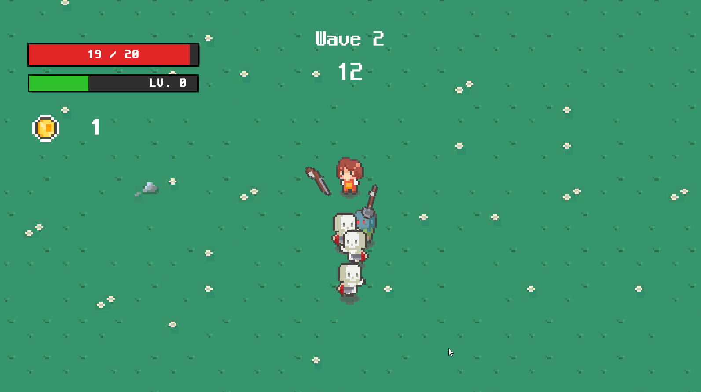
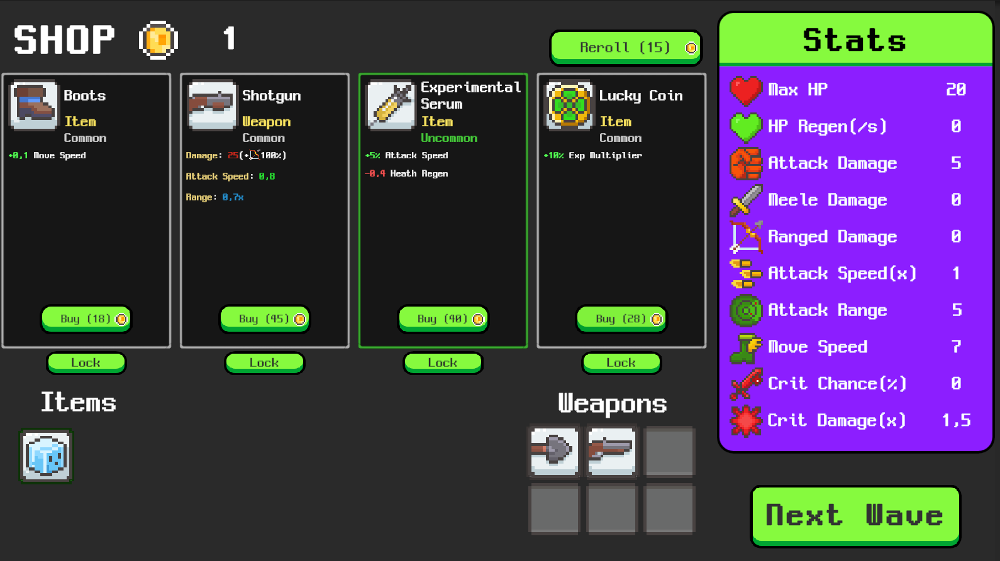
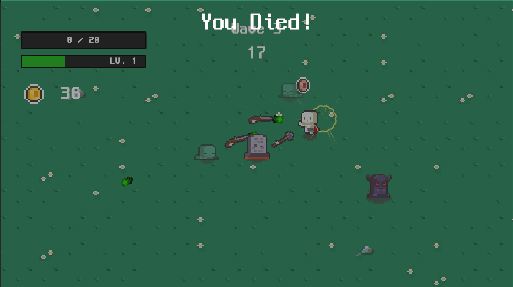

# 🌾 Undead Harvest

> **2D Roguelike / Survivor** built with **Unity 6**

Fight through relentless waves of undead as a fearless farmer armed with
firearms and gardening tools. Purchase upgrades between waves,
experiment with different builds, and survive increasingly difficult
encounters.

---

# 🎥 Gameplay

> **Gameplay Video**

https://github.com/user-attachments/assets/3176bdfe-f71b-43af-86fa-c495a9c31ff9

## 📸 Screenshots

---

 

---

---

# ✨ Features

- Wave-based progression system
- Inventory System
- Status Effects System
- Object Pooling
- Dependency Injection (VContainer)
- ScriptableObject-driven architecture
- Single Entry Point (Bootstrap)
- Shop between waves
- Multiple enemy types and boss encounter

## Architecture notes

- VContainer wires scene services and game-flow states. `EnemyRegistry` is an injected scene service; `CombatSystem` is a stateless static damage helper.
- Enemy caps are configured per enemy type in each wave. Spawn points are selected inside the map bounds while respecting a minimum distance from the player.
- Weapons search active enemies for targets and briefly hold the current target before switching to a different candidate.
- Shop rarity weights select a preferred rarity. If the selected item category has no matching rarity, the shop falls back to an available item from that category. Rarity stat multipliers are used by level-up offers, not shop prices.
- Current implementation details and known caveats are documented in [CODEX.md](CODEX.md).

---

# 🛠 Technologies

- Unity 6
- C#
- VContainer
- R3 (Reactive Extensions) (BETA)
- NTC Pool
- DOTween
- Cinemachine

---

Open the project using **Unity 6**.
